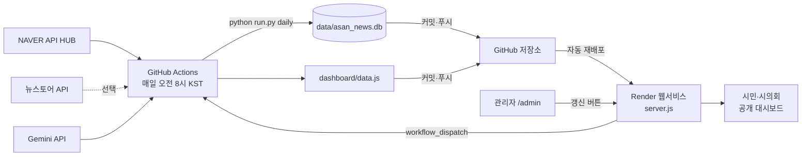

# 아산시 홍보 사업 성과 분석 시스템

아산시 관련 온라인 뉴스를 **매일 자동 수집**하고, 같은 보도자료로 쓴 기사를 **이슈로 묶고**, 보도량·확산·매체·주제를 **통계 분석**한 뒤 **AI(Gemini)가 공무원 보고서체로 해석**해 웹 대시보드로 공개하는 시스템입니다.

- 공개 대시보드 `/` · 성과 통계 보고서 `/report.html` · 교육과정 소개 `/course.html` · 관리자 `/admin`
- 운영: 사단법인 도시공동체본부 · Powered By YILOWOON

> 💡 **처음이라면** API 키 없이 `python run.py sample`로 샘플 화면부터 띄워 보세요.
> 🤖 **AI로 직접 만들어 보려면** PROMPT.md의 배포용 프롬프트를 순서대로 붙여 넣으세요.

---

## 1. 아키텍처



무거운 작업(수집·분석·AI)은 GitHub Actions가 하루 한 번 하고, Render는 결과 파일만 제공합니다. 어떤 단계가 실패해도 기존 화면은 그대로 유지됩니다.

## 2. 폴더 구조

| 경로 | 역할 |
|---|---|
| `run.py` | 명령어 진입점 (`daily`, `collect`, `newstore`, `bigkinds`, `cluster`, `views`, `build`, `report`, `sample`) |
| `asannews/config.py` | 검색어·지역어·제외어·주제 키워드·임계값 — **지역을 바꿀 때 이 파일만 수정** |
| `asannews/db.py` | SQLite 테이블(articles, clusters, runs) |
| `asannews/collect.py` | NAVER API HUB 뉴스 검색 수집 |
| `asannews/newstore.py` | 뉴스토어(빅카인즈) API 기간 수집(선택) |
| `asannews/bigkinds.py` | 빅카인즈 엑셀 가져오기 |
| `asannews/text.py` | 정제·관련성 판단·주제 분류·매체명 |
| `asannews/cluster.py` | 유사 제목 → 이슈 통합 |
| `asannews/views.py` | 원문 페이지에서 매체명·조회수 확인 |
| `asannews/stats.py` | 통계 분석(숫자는 여기서만 만듦) |
| `asannews/llm.py` | Gemini 해석(숫자를 만들지 않음) |
| `asannews/report.py` | 통계 + AI 결과 묶기, 실패 시 직전 해석 재사용 |
| `asannews/export.py` | DB → `dashboard/data.js` |
| `asannews/sample.py` | 키 없이 화면 확인용 샘플 데이터 |
| `dashboard/` | `index.html`(대시보드·관리자), `report.html`(보고서), `course.html`(교육과정), `assets/` |
| `server.js`, `package.json` | Render 웹서비스(의존성 없음, `npm start`) |
| `render.yaml` | Render Blueprint |
| `.github/workflows/daily.yml` | 매일 자동 실행 |

## 3. API 키 발급

| 키 | 발급처 | 필수 |
|---|---|---|
| `NAVER_CLIENT_ID` / `NAVER_CLIENT_SECRET` | NAVER API HUB(네이버 클라우드 플랫폼) → 검색 API 이용 신청. 기존 네이버 개발자센터 검색 API는 API HUB로 이관되었으므로 API HUB에서 발급받은 키를 씁니다. | 예 |
| `GEMINI_API_KEY` | Google AI Studio → API 키 만들기 | AI 해석 시 |
| `NEWSTORE_API_KEY` | 뉴스토어(빅카인즈) 뉴스검색 API 신청 | 선택 |

> ⚠️ 키는 **절대 코드·README·프롬프트·커밋에 넣지 마세요.** 로컬은 `.env`, Actions는 GitHub Secrets, Render는 Environment에 넣습니다.

## 4. 로컬 실행

```bash
pip install -r requirements.txt
```

```bash
python run.py sample
```

```bash
python -m http.server 8765 --directory dashboard
```

브라우저에서 http://localhost:8765 를 엽니다(화면 상단에 '샘플' 띠가 표시됨). 실제 데이터로 돌리려면 다음과 같이 합니다.

```bash
cp .env.example .env
```

`.env`에 키를 직접 입력한 뒤 실행합니다.

```bash
python run.py daily
```

관리자 모드까지 확인하려면 Node 서버를 씁니다(`.env`의 ADMIN_ID / ADMIN_PASSWORD를 환경변수로 넘김).

```bash
ADMIN_ID=admin ADMIN_PASSWORD=원하는비밀번호 npm start
```

http://localhost:3000/admin 에서 로그인합니다.

## 5. 기능 상세

**수집과 정제**
- 검색어별 최신순으로 최대 1,000건을 가져오고, 시작일 이전 기사가 나오면 멈춥니다.
- 제외어(서울아산병원, 현대아산 등)를 지운 뒤에도 '아산'이 남는 기사만 저장합니다. 이때 제목에 지역명이 있거나 본문에 지역어가 있어야 합니다.
- 중복은 URL 기준으로 걸러 냅니다.

**이슈 통합**
- 제목을 정규화한 뒤 문자 2-gram 자카드 유사도가 0.45 이상이면 같은 이슈로 봅니다.
- 3일 이내 기사끼리만 비교하고, 한 이슈의 기간은 최대 7일입니다.
- 대표 제목은 medoid(다른 제목과 평균 유사도가 가장 높은 제목)입니다.

**대시보드**
- 화면 구성: KPI 6개(직전 동기간 대비), 보도·조회수 추이, 주제별 분포, 매체 TOP 15, 홍보 성과 요약 6개 지표, 기간별 성과표, 주요 이슈(펼침·정렬·검색·CSV), 기사 목록
- 기간 프리셋과 일·주·월 집계 단위, 주제 필터를 고를 수 있습니다.
- 라이트·다크 모드를 지원합니다.

**통계 보고서**
- 분석 항목: 기술통계, 추세(회귀·Spearman), 상관(Pearson·95% CI·Holm 보정)과 상관행렬, 요일 효과(Mann-Whitney·Kruskal-Wallis), 주제별 확산력(ε²), 주제 구성 변화(χ²·Cramér's V), 홍보비 연계
- 각 장에 AI 해석 박스가 붙습니다.

**관리자**
- `/admin`에서 로그인하면 [최신 데이터로 갱신] 버튼으로 GitHub Actions를 바로 실행할 수 있습니다.
- 갱신 요청은 10분 쿨다운이 있고, 이미 실행 중이면 거절됩니다.
- 로그인 보호: HMAC 서명 쿠키(8시간)를 쓰고, IP별 5회 실패 시 15분, 전체 1시간 20회 실패 시 1시간 동안 잠깁니다.

## 6. API 연동 코드(요약)

```python
# NAVER API HUB 뉴스 검색 (asannews/collect.py)
GET https://naverapihub.apigw.ntruss.com/search/v1/news?query=아산시&display=100&start=1&sort=date
X-NCP-APIGW-API-KEY-ID: <NAVER_CLIENT_ID>
X-NCP-APIGW-API-KEY:    <NAVER_CLIENT_SECRET>

# Gemini (asannews/llm.py)
POST {GEMINI_BASE_URL}/v1beta/models/{GEMINI_TEXT_MODEL}:generateContent
x-goog-api-key: <GEMINI_API_KEY>
generationConfig: {"temperature": 0.2, "responseMimeType": "application/json"}
```

## 7. GitHub Secrets · Render 설정

**GitHub 저장소 → Settings → Secrets and variables → Actions**
- 등록할 값: `NAVER_CLIENT_ID`, `NAVER_CLIENT_SECRET`, `GEMINI_API_KEY`, `NEWSTORE_API_KEY`(선택)
- Settings → Actions → General → Workflow permissions에서 **Read and write**를 선택합니다.

**Render → New → Blueprint → 저장소 선택 → Environment**
- `ADMIN_ID`, `ADMIN_PASSWORD`: 관리자 계정
- `GITHUB_TOKEN`: Fine-grained 토큰. 대상 저장소만 선택하고, 권한은 Actions: Read and write와 Contents: Read로 줍니다.
- `GITHUB_REPO`: `계정명/저장소명`

## 8. 지역 바꾸기

`asannews/config.py`에서 다음 값을 바꿉니다.
- `REGION`, `REGION_SHORT`, `UPPER_REGION`, `START_DATE`
- `QUERIES`, `LOCAL_WORDS`, `EXCLUDE_WORDS`
- `BRAND_COLORS`

그다음 화면 문구(`dashboard/*.html`의 '아산시'), 로고와 OG 이미지(`dashboard/assets/`)를 교체하고 `python run.py sample`로 확인합니다. '중구'처럼 같은 지명이 여러 곳에 있는 지역은 제외어를 꼼꼼히 넣으세요.

## 9. FAQ

- **Q. `.env 파일에 NAVER_CLIENT_ID ...` 메시지가 나와요.**
  `.env.example`을 `.env`로 복사하고 값을 입력했는지 확인하세요.
- **Q. 보고서에 'AI 해석 없음'이 떠요.**
  `GEMINI_API_KEY`와 `GEMINI_TEXT_MODEL`을 설정하고 `python run.py report`를 실행하세요. AI 호출이 실패하면 직전 해석을 재사용합니다.
- **Q. 워크플로 파일 푸시가 거부돼요.**
  Git 인증에 `workflow` 권한이 없으면 생기는 문제입니다. GitHub 웹에서 `.github/workflows/daily.yml`을 직접 만들어 붙여 넣으세요.
- **Q. 관리자 갱신 버튼이 비활성이에요.**
  Render 환경변수 `GITHUB_TOKEN`과 `GITHUB_REPO`를 확인하세요.

## 10. 데이터 한계

- 포털 검색 API 기반이라 검색어에 걸리지 않는 기사, 지면·방송 보도는 누락될 수 있습니다(수집 편향).
- 조회수는 공개 매체 일부에서만 확인되어 전체 도달 규모를 대표하지 않습니다.
- 이슈 통합과 주제 분류는 자동 규칙에 따른 것이라 오분류가 있을 수 있습니다.
- 상관관계는 인과관계가 아닙니다.

<p align="center"><sub>Powered By <b>YILOWOON</b> · © 2026 사단법인 도시공동체본부</sub></p>
